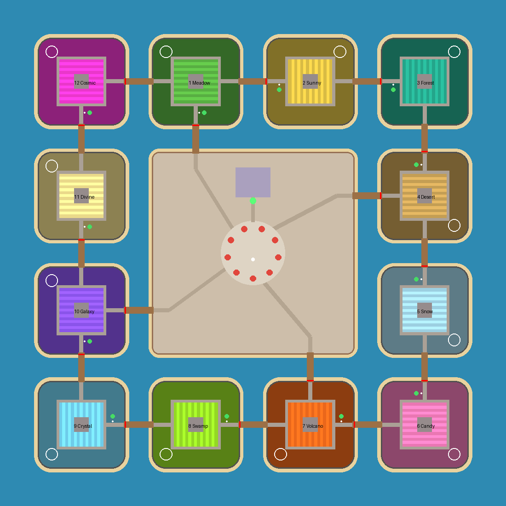

# Mow the World

A Roblox mowing simulator built in Place3.rbxl (local, unpublished). Players cut grass, sell it, buy better gear, collect workers, beat area bosses to unlock new islands, and rebirth for permanent bonuses.

## Status (10 Nov 2026)

**Working, tested in play mode:** daily reward, mowing, selling, crate opening, equipping workers, bag purchase, area 1 boss fight, unlocking area 2, bridges, locked gates. No console errors.

**Before launch:**
1. **Save the place in Studio (Ctrl+S).** The rework was done in the open session.
2. **Publish and enable Studio access to API services** (Game Settings → Security). Until then profiles load with `noSave = true` and nothing is saved.
3. **Create gamepasses and developer products** in the Creator Dashboard and paste their ids into `Config.Game` (`G.Passes`, `G.Products`). All ids are 0 now.

**Untested:** vehicles, rebirth, bosses and balance from area 3 onward, multiplayer, mobile and console controls.

**Possible polish:** mower and vehicle models are basic parts.

**Visual rework (24 Nov 2026), not yet tested in Studio:** new map layout, lawn-style grass, brighter lighting and a restyled HUD and menus (see Map and UI below). The terrain re-bakes on the first start because `LAYOUT_VERSION` changed.

## Core loop

1. Walk over a bridge into an unlocked area. The equipped mower cuts grass automatically around the player.
2. Grass fills the bag. Sell at a 💰 pad (one per area, one in the marketplace) or with Auto Sell.
3. Spend cash on mowers, bags, vehicles and worker crates.
4. Find treasure chests hidden under the grass.
5. Equipped workers follow the player, mow nearby grass and fight bosses.
6. Beat the area boss to unlock the next area. Clearing 100% of the grass does not unlock anything.
7. Spend diamonds to rebirth.

## Map



- An archipelago on a 4×4 grid: a town island in the middle 2×2 block and twelve 360-stud area islands in a ring around it (`Areas.CELL`). Island centres are 470 studs apart (`Areas.PITCH`). The town is sized to reach as far as the islands around it (`Areas.MARKET_HALF` = 415), so every stretch of sea, and every bridge, is 110 studs (`Areas.GAP`).
- **Bridges:** the town has one bridge on each side, turning like a pinwheel, to areas 1, 4, 7 and 10 (`Areas.TOWN_LINKS`). Every area has a bridge to the next one, and area 12 has one back to area 1, so the ring can be walked all the way round. A locked gate (force field) stands at the area end of each bridge until the previous boss is beaten. Each gate stores where its bridge starts (`From`), and the guide arrow uses the nearest one.
- **Inside an area island** everything is placed relative to its entrance (`a.front`: the bridge from the previous area, or from town for area 1):
  - a 30×30 grass field (6-stud tiles) in the middle, with a 10×10 hole for the boss plaza: a paved square with four glowing obelisks. No grass grows on the plaza (`Areas.tileExists`), so each area has 800 tiles.
  - under the grass, a mown lawn in two-tone stripes that shows wherever grass has been cut
  - a stone walk round the field with a lamp at each corner, and a path from every bridge to the walk
  - the sell pad just inside the entrance, beside the path (`Areas.SELL_SPOT`); teleports land between the two (`a.spawnPos`)
  - the landmark in the back corner, facing the field (`Areas.LANDMARK_SPOT`)
  - themed props in groves with open ground between them, clear of the paths, sell pad and landmark
- Grass height and shade come from smooth noise, so a field reads as one gently rolling lawn rather than a checkerboard.
- There are no fences. Each area is ringed by its own edge (`EDGES` in WorldBuilder): rock cliffs whose colour, height, caps, lava cracks or crystals change with the theme, or high walls with battlements and towers. An invisible barrier inside the edge keeps players in; the only gaps are the bridges.
- The marketplace is a paved cartoon town inside a 48-stud town wall with big round towers: the fountain, nine shops in a ring, four streets that each lead to one bridge, up to 150 pastel houses with bright roofs, trees in stone planters, lamps, benches and bunting. It has no NPCs, no signposts round the fountain and almost no grass.
- **World boss portal:** a glowing green circle in front of the castle gate (`Areas.PORTAL_POS`). Standing on it opens the world boss card (Start / Join the fight, or a timer while the boss rests).
- A castle (`Scenery.castle`) stands at the north end of town, at the end of an avenue from the plaza. It is scenery only: an invisible wall all the way round keeps players out.
- Terrain (islands, beaches, sea) is baked into the place file and only re-bakes when `LAYOUT_VERSION` in WorldBuilder changes. Smooth terrain renders 2 studs above the filled volume, so islands are filled to y = -2.3 and parts are built at y = 0.
- Everything else is rebuilt by `WorldBuilder.build()` on every server start.

## UI

- Built in code from the pieces in `Client.UI`: the theme colours, glossy outlined buttons, dark rounded panels, pill-shaped progress bars and round icon badges. Changing them there restyles every menu.
- **HUD:** currencies top left (with a + button that opens the shop), and under them the six menus that work anywhere in a 2×3 grid: Workers, Items, Teleport, Daily, Shop and Menu. The area name and the current objective sit in capsules at the top, active boosts on the right, and the grass progress and bag bars at the bottom, with the Ride button beside them.
- **Menus** open in one window whose header takes the menu's colour; the world behind it is blurred. Everything else (Crates, Mowers, Bags, Rebirth, Diamonds, Awards, Settings) is behind the Menu button and at the shops in town.

## Areas

Grass HP = 5 × 5^(n−1). Grass value = 4^(n−1). Boss HP = grass HP × 120, boss cash = value × 1,500, boss diamonds = 5 + 3n.

| # | Area | Boss | Landmark |
|---|---|---|---|
| 1 | Starter Meadow | Dandelion Brute | Red barn and silo |
| 2 | Sunny Fields | Sunflower Titan | Windmill |
| 3 | Enchanted Forest | Elder Treant | Giant tree house |
| 4 | Desert Dunes | Scorpion King | Pyramid |
| 5 | Snowy Mountains | Frost Yeti | Snowy peak and igloo |
| 6 | Candy Kingdom | Gummy Golem | Candy castle |
| 7 | Volcanic Lands | Magma Lord | Volcano |
| 8 | Toxic Swamp | Sludge Hydra | Witch hut on stilts |
| 9 | Crystal Valley | Crystal Colossus | Crystal spires |
| 10 | Galaxy Fields | Nebula Wraith | Ringed planet |
| 11 | Divine Gardens | Seraph Guardian | Marble temple |
| 12 | Cosmic Dimension | Void Emperor | Void portal |

- **Grass rewards:** clearing 250 / 500 / 1,000 / 2,000 grass tiles in area 1 pays 150 / 400 / 900 / 2,500 × grass value; the last one also gives a crate. Each later area needs 50% more grass (area 2: 375, 750, 1,500, 3,000). Settings are in `Config.Areas` (`MILESTONES`, `MILESTONE_GROWTH`).
- **Mowing feel:** the server steps 30 times a second and keeps a timer per player per tile, so grass is hit the moment it comes within reach of the mower and again every 1 / speed seconds while it stays there. When one hit is enough, the client also hides the tile on the player's own screen at once (`predictCuts` in Client.World, using `LocalTransparencyModifier` for 0.6 s) and the server's answer follows. Scissors do 5 damage so starter grass is cut in one hit.
- **Regrowth:** grass regrows after 16 seconds.
- **Boss fights:** walking onto the boss plaza in the middle of an area opens a prompt: Solo, Invite friends (everyone on the server who has the area unlocked gets 15 seconds to join) or Exit. Each fight gets its own arena, built far from the islands, and its players are teleported there and back. Fights last 120 seconds and each extra player adds 60% boss HP.
- **Boss attacks:** the boss walks around the arena and repeats its own attack sequence (`BOSS_MOVES` and `Areas.Moves` in `Config.Areas`). Attacks only hit workers, never players. Boss attack = 6 × grass value per hit.
- **World boss (Overgrowth King):** one fight for the whole server, in its own arena (a ruined colosseum on a floating rock, `buildWorldArena` in Boss). The first player through the portal starts it; anyone can join until the last 25 seconds. Settings are in `Config.Game` (`G.WorldBoss`).
  - Health: 200 seconds of the first player's own full damage (workers + mower), plus 120 seconds for each player who joins later. The time limit is 240 seconds, so one player alone is very unlikely to win and a group has a real chance.
  - Attacks take a share of each worker's own health (7% x the attack's strength), so it is as dangerous to a strong squad as to a weak one. It gets faster and hits harder at 50%, 25% and 10% health.
  - Rewards are shared by damage dealt. Win: your best area's boss cash x (2 + 10 x your share), 10 + 40 x share diamonds, a crate for dealing 10% or more, and one more crate for the top player. Lose: boss cash x 4 x your share x the fraction of health the boss lost.
  - The boss rests for 120 seconds after every fight. The fight HUD shows each player's own share of the damage.
- **Worker health:** 10 × power. A worker at 0 health is knocked out until the fight ends.
- **Teleport:** the Teleport menu jumps to the marketplace or any unlocked area (3 second cooldown).

## Items

- **Mowers (20):** Scissors, Garden Shears, Push, Electric, Petrol, Professional, Ride-On, Zero-Turn, Commercial, Industrial, Mega. Rebirth-only: Golden (R1), Diamond (R2), Plasma (R3), Toxic (R5), Inferno (R7), Galaxy (R10), Rainbow (R15), Divine (R20), Cosmic Mega (R30). Each has damage, speed, radius, efficiency, price and area requirement.
- **Bags (9):** Tiny 25 → Small 100 → Medium 400 → Large 1.5K → Huge 6K → Massive 25K → Professional 100K → Industrial 500K → Infinite.
- **Vehicles (10):** Lawn Tractor, Ride-On, Buggy, Pro Tractor, Heavy-Duty, Industrial Machine, Mega Vehicle. Rebirth: Phoenix Cruiser (R3), Starship (R8). Gamepass: Royal Limo-Mower. Each has speed, damage multiplier, radius and storage multiplier. Toggle with the 🚜 Ride button.

## Workers and crates

- **Workers:** 24 across 8 rarities (Common, Uncommon, Rare, Epic, Legendary, Mythic, Secret, Divine). Higher rarities glow and have particles.
- **Upgrades:** level up with cash (max level 25), add stars with diamonds (max 3 stars).
- **Inventory:** holds 250. Players can lock, delete, sort by power or rarity, and use Equip Best.
- **Slots:** 3 base, plus rebirth milestones, the diamond shop (+2) and a gamepass (+2).
- **Crates (6):** Basic, Grass, Golden, Mythic, Secret, Divine. They have area requirements and show odds before opening. Players can open 1 or 3, Auto Open, or use crates they already own. A rarity-coloured reveal animation plays on opening. Crates also come from chests, bosses, milestones and daily rewards.

## Chests, diamonds, rebirth

- **Chests:** 4 hidden per area, respawning after 40 seconds. Rarities Common to Legendary; a rarer chest gives more cash and diamonds, more luck and a better chance of a double spin.
- **Chest spin:** opening a chest plays a reel (`Client.ChestSpin`): the screen blurs, an aura in the chest's colour turns behind it, and each column spins through what the chest can hold and stops on one prize. The server decides everything in `Chests.open` and gives the prizes straight away; the client only plays the show. Settings are in `Config.Game` (`G.ChestSpin`).
  - Prizes: cash, a cash jackpot (5x), diamonds, a 5-minute boost, a worker crate, a chest worker, or a luck prize.
  - **Luck prizes** (2x or 3x) are not rewards: they start another spin in a new column with that much more luck, up to two in a row. Luck makes workers more likely and pushes them towards the rarer end.
  - **Double spin:** 8% (Common chest) to 40% (Legendary chest) chance of two columns side by side.
  - **Chest workers** (`W.ChestList`) are one per rarity, stronger than crate workers of the same rarity, and never come from crates. Which rarity a worker prize is depends on the islands: areas 1-4 are mostly Common to Rare, 5-8 Uncommon to Mythic, 9-12 Rare to Divine.
  - Epic workers get their colour, a banner and confetti; Legendary and better add a flash, a second burst and a shake.
  - **First chest:** a player's first ever chest always lands on an Epic (85%), Legendary (13%) or Mythic (2%) chest worker.
- **Diamonds:** come from bosses, rare chests, achievements, daily rewards and Robux. Never from area completion.
- **Diamond shop:** permanent Auto Sell, +1 worker slot (×2), 15-minute boosts (cash, speed, luck), Mythic and Secret crates.
- **Rebirth** (Rebirth Shrine):
  - Cost 40 + 30n + 5n² diamonds. Requires area min(12, 4 + n).
  - Resets cash, areas, mowers, bags, vehicles and grass progress.
  - Keeps diamonds, workers, crates, titles, perks, stats and passes.
  - Bonuses: cash ×(1 + 0.5n), power ×(1 + 0.5n), worker damage ×(1 + 0.25n), +1 worker slot at R2, R5 and R10.
  - Titles at R1, R5, R10 and R25.

## Progression extras

- **Daily rewards:** 7-day streak. Rewards in order: cash, 5 diamonds, crate, 2× cash for 15 minutes, 15 diamonds, 3 crates, 40 diamonds plus a title.
- **Achievements (10, tiered):** grass cut, cash earned, chests, bosses, areas, rebirths, crates opened, rare / legendary / secret workers found. They reward diamonds and titles.
- **Leaderboards (OrderedDataStore):** grass, cash, bosses, rebirths, diamonds, worker power.

## Robux

- **Gamepasses:** VIP, 2× Cash, 2× Grass, Auto Sell, Faster Mowing, Extra Worker Slots, Bigger Starting Bag, Premium Vehicle Pack, 2× Diamonds, All Access.
- **Developer products:** three cash packs (scaled to the player's best area), 100 / 600 / 3,000 diamonds, and 30-minute cash, speed and luck boosts.
- **Purchase handling:** passes are checked with `UserOwnsGamePassAsync`. Products go through `ProcessReceipt`, which keeps a receipt log so a purchase can't be granted twice.

## Code layout

```
ServerScriptService
  Main                 boots every service in order
  Services/
    Data               profiles, DataStore (UpdateAsync), 120s autosave, BindToClose, leaderstats
    WorldBuilder       terrain, bridges, gates, cliffs and walls, areas, town, lighting
    Scenery            12 landmarks + cartoon town houses
    Grass              grass grid, server-side mowing, bag, selling, milestones, regrowth
    Crates             crate rolls and opening
    Chests             hidden chests and rewards
    Boss               arenas, fights, attacks, rewards
    Character          held mower, vehicles, walk speed (base 20)
    Shop               single Action RemoteFunction: validates and runs every request
    Monetization       gamepasses and receipts
    Progress           achievements, leaderboards
ReplicatedStorage
  Shared/Config/       Areas, Items, Workers, Game   (all tunable numbers live here)
  Shared/Models        procedural models: workers, mowers, vehicles, crates, bosses, props
  Shared/Util
  Remotes/             Action (RemoteFunction); DataSync, Notify, GrassFx, Gain, Milestone, ChestFx, BossFx
StarterPlayerScripts/Client
  Main, State          startup, local copy of player data
  UI                   theme, buttons, panels, bars, badges, sounds, 3D previews
  Menus                HUD, notifications, menu framework
  Panels               contents of every menu, crate reveal
  World                gates, sky per area, animations, effects, worker followers
```

The UI is built in code (ScreenGui `MowUI`), so StarterGui is empty by design.

## Security

- The server does all mowing, damage, rewards and currency. The client never reports what it cut.
- Every `Action` call is rate-limited (8 per second, burst of 16) and type-checked.
- Shop purchases require the player to be near the right shop.
- Crate, chest, boss and receipt rewards are granted only by the server.

## Adding content

- **New area:** append to `DEFS` in `Config.Areas`, give it a free cell in `RING` next to the previous area (widen the grid if needed), add a landmark function in `Scenery`, and bump `LAYOUT_VERSION` in WorldBuilder.
- **Mowers, bags, vehicles:** append to the lists in `Config.Items`.
- **Workers, crates:** add them in `Config.Workers`.
- **Achievements, daily rewards, diamond shop, passes:** edit `Config.Game`.
