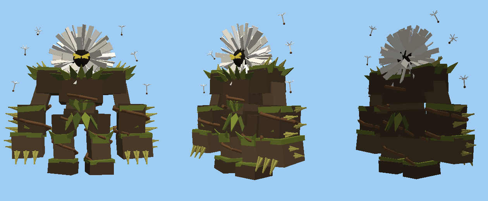

# Dandelion Brute — model build spec

Boss of area 1 (Starter Meadow). Built from parts in `Models.luau` (`BOSS_BUILDERS[1]`),
following a reference picture: a hulking bark golem wrapped in vines, with a dandelion
seed-head for a head.

All sizes are in units of `S` = the boss's `size` in `Config.Areas` (7 studs), so the model
scales with it. The model stands on y = 0 and faces −Z, like every boss. About 460 parts.

## Proportions (height ≈ 2.75 S, width ≈ 2.5 S fist to fist)

| Part | From – to (y, in S) |
|---|---|
| feet (with moss on top) | 0 – 0.24 |
| shins, then thighs (vines wound round) | 0.21 – 1.09 |
| hips and the leaf skirt | 0.9 – 1.17 |
| belly, chest (vine round it) | 1.1 – 1.81 |
| shoulders (moss, thorns, leaves) | 1.47 – 1.9 |
| gauntlets (forearms) | 0.7 – 1.26 |
| fists with claws | 0.3 – 0.72 |
| seed-head: dark core and strips | about 1.5 – 2.75 |

Every bark block is skewed a little (`jit`), for a rough, chiselled look.

## Exact counts

| Feature | Count |
|---|---|
| seed-head strips (front left open for the face) | 100 placed, about 85 shown |
| leaf skirt | 12 leaves |
| collar leaves / hanging belly leaves | 7 / 5 |
| thorns per shoulder | 3 |
| thorns per gauntlet / per fist side | 4 / 2 |
| claws per fist | 3 |
| vines | 1 per leg, 1 round the chest, 1 per gauntlet |
| floating seeds (6 spokes each) | 6 |

## Colours

| Part | Hex |
|---|---|
| bark (dark) | #4A3A2A |
| bark (light) | #604C36 |
| vines | #6B4A2E |
| moss | #6E7A2E |
| leaves | #828E36 / #56622A |
| thorns and claws | #AAA24C |
| seed-head strips | #F2ECDC / #FFFCF4 |
| head core | #1E1A14 |
| eyes | #FFE650 |

Materials: Wood for bark and vines, Grass for moss, smooth plastic for leaves, thorns and strips.

## What glows

- the yellow slit eyes (with a light)
- the seed spokes; white seeds drift up and away from the head (particles)

## Moving parts

None of its own: the fight code moves the whole model (walking, turning, attacks).

## Limits compared with the reference

The reference has painted bark and moss textures and sculpted meshes. This version is built
from blocks, wedges and cylinders, so it is chunkier and the bark is flat Wood material. A
closer match needs the model sculpted and textured in Blender and imported as a mesh.

## Preview

Ray-traced from a Python copy of the builder (not a Studio screenshot): front, three-quarter
and back three-quarter.

